# PetCare_POO

Es un sistema de consola en Java que permite administrar una clínica veterinaria, se realizó como examen parcial de la EE. Diseño y Programación Orientada a Objetos (Licenciatura en Ingeniería de Software, Universidad Veracruzana)

## Tabla de contenido

- [Descripción](#descripción)
- [Tecnologías](#tecnologías)
- [Modelo de la solución](#modelo-de-la-solución)
- [Estructura del proyecto](#estructura-del-proyecto)
- [Conceptos aplicados](#conceptos-aplicados)
- [Instalación y ejecución](#instalación-y-ejecución)
- [Ejemplos de uso](#ejemplos-de-uso)
- [Reglas de negocio](#reglas-de-negocio)
- [Reflexión](#reflexión)
- [Autor](#autor)

## Descripción

Una clínica veterinaria pequeña suele llevar sus citas, sus cobros y los expedientes de las mascotas en papel o en hojas de cálculo sueltas, y eso provoca citas encimadas, cobros que nadie puede rastrear e historiales incompletos.

PetCare_POO resuelve ese problema con una aplicación de consola que permite:

- registrar dueños y sus mascotas (perros, gatos y aves exóticas)
- registrar veterinarios y asignarlos a la clínica
- agendar citas con uno o varios servicios (consulta general, vacunación, cirugía) sin que se empalmen
- atender o cancelar citas, y guardar cada consulta atendida en el historial clínico de la mascota
- generar comprobantes con folio único y consultar cuánto ha cobrado cada veterinario
- dar de baja una mascota junto con su historial

El programa valida todo lo que se escribe (texto donde va un número, opciones fuera del menú, datos vacíos)

## Tecnologías

| Herramienta | Versión / detalle                                   |
|---|-----------------------------------------------------|
| Java | 17 o superior (desarrollado y probado con OpenJDK 21) |
| Diagramas UML | PlantUML (fuente en [`docs/diagramas/codigoUML.md`] |
| IDE | [IntelliJ IDEA]                                     |
| Control de versiones | Git y GitHub                                        |

Solo utiliza la librería estándar de Java

## Modelo de la solución

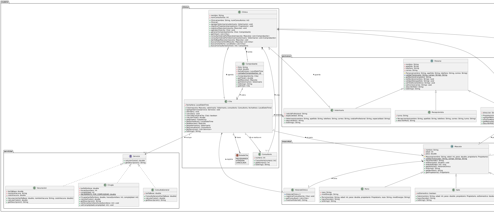
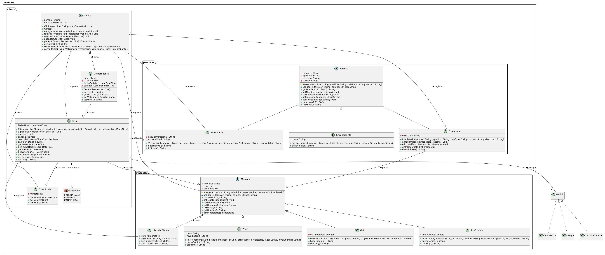

### Decisiones de diseño

**Herencia (dos jerarquías).** Lo que es común vive en el padre y lo específico en las hijas

- `Persona` (abstracta) guarda nombre, apellido, teléfono y correo, y valida esos datos una sola vez. Sus hijas son `Propietario`, `Veterinario` y `Recepcionista`, y cada una implementa `describirRol()`.
- `Mascota` (abstracta) guarda nombre, edad, peso, propietario e historial. Sus hijas son `Perro`, `Gato` y `AveExotica`, y cada una implementa `hacerSonido()`.

**Interfaz.** `Servicio` define qué debe saber hacer cualquier cosa que se cobre en una cita: `calcularCosto()` y `getDescripcion()`. La implementan `ConsultaGeneral`, `Vacunacion` y `Cirugia`, cada una con su propia fórmula. Se eligió interfaz y no herencia porque los tres servicios no comparten atributos, solo un contrato, así `Cita` suma costos sin saber de qué tipo es cada servicio, y agregar un servicio nuevo no obliga a tocar `Cita`.

**Composición** (la parte no existe sin el todo, ya que se crea dentro del contenedor y no se comparte)

- `Clinica` ◆— `Consultorio`: la clínica crea sus consultorios en su constructor. Un consultorio no tiene sentido fuera de ella
- `Clinica` ◆— `Comprobante`: solo la clínica emite comprobantes y viven mientras exista
- `Mascota` ◆— `HistorialClinico`: el historial se crea dentro de la mascota y su constructor es de acceso de paquete, para que nadie lo cree suelto. Si la mascota desaparece, su historial desaparece con ella

**Agregación** (el objeto existe por sí mismo y la clínica solo lo agrupa)

- `Clinica` ◇— `Veterinario`, `Propietario`, `Mascota` y `Cita`: se crean fuera y se entregan ya hechos. Si la clínica dejara de existir, esas personas y mascotas seguirían existiendo.

**Asociación.** `Cita` solo referencia a una `Mascota`, un `Veterinario` y un `Consultorio` que ya existen independientemente. `Comprobante` referencia a la `Cita` que cobra.

## Estructura del proyecto

```
PetCare/
├── README.md
├── .gitignore
├── docs/
│   ├── analisis.md                 # análisis del problema
│   ├── capturas/                   # capturas de la ejecución
│   └── diagramas/
│       ├── capturas/               # imágenes del diagrama de clases
│       │   ├── parte1 diagramas uml.png
│       │   └── parte2 diagramas uml.png
│       └── codigoUML.md            # código fuente del diagrama UML
└── src/
    ├── app/
    │   └── Main.java
    └── modelo/
        ├── clinica/
        │   ├── Clinica.java
        │   ├── Consultorio.java
        │   ├── Cita.java
        │   ├── EstadoCita.java
        │   └── Comprobante.java
        ├── mascotas/
        │   ├── Mascota.java
        │   ├── Perro.java
        │   ├── Gato.java
        │   ├── AveExotica.java
        │   └── HistorialClinico.java
        ├── personas/
        │   ├── Persona.java
        │   ├── Propietario.java
        │   ├── Veterinario.java
        │   └── Recepcionista.java
        └── servicios/
            ├── Servicio.java
            ├── ConsultaGeneral.java
            ├── Vacunacion.java
            └── Cirugia.java
```

| Paquete | Propósito |
|---|---|
| `app` | Punto de entrada: el menú de consola y la lectura validada de datos. No contiene reglas de negocio|
| `modelo.personas` | Quién interviene: `Persona` y sus hijas (dueño, veterinario, recepcionista) |
| `modelo.mascotas` | Los pacientes: `Mascota`, sus especies y el `HistorialClinico` |
| `modelo.clinica` | La operación: la `Clinica`, sus consultorios, citas, estados y comprobantes || `modelo.servicios` | Lo que se cobra: la interfaz `Servicio` y sus tres implementaciones |

En el proyecto hay 19 tipos: 17 clases (2 de ellas abstractas), 1 interfaz y 1 enum.

## Conceptos aplicados

| Concepto | Dónde se aplica                                                                                                                                                                                                                                                                                                                                        |
|---|--------------------------------------------------------------------------------------------------------------------------------------------------------------------------------------------------------------------------------------------------------------------------------------------------------------------------------------------------------|
| Clase abstracta | [`Persona.java:5`](src/modelo/personas/Persona.java#L5), [`Mascota.java:5`](src/modelo/mascotas/Mascota.java#L5)                                                                                                                                                                                                                                       |
| Método abstracto (implementado en cada hija) | `describirRol()` en [`Persona.java:55`](src/modelo/personas/Persona.java#L55); `hacerSonido()` en [`Mascota.java:34`](src/modelo/mascotas/Mascota.java#L34)                                                                                                                                                                                            |
| Herencia y uso de `super(...)` | [`Propietario.java:10`](src/modelo/personas/Propietario.java#L10) y [`:16`](src/modelo/personas/Propietario.java#L16), [`Perro.java:4`](src/modelo/mascotas/Perro.java#L4) y [`:10`](src/modelo/mascotas/Perro.java#L10), [`Gato.java:5`](src/modelo/mascotas/Gato.java#L5) y [`:10`](src/modelo/mascotas/Gato.java#L10)                               |
| Interfaz | Declarada en [`Servicio.java:7`](src/modelo/servicios/Servicio.java#L7); implementada en [`ConsultaGeneral.java:4`](src/modelo/servicios/ConsultaGeneral.java#L4), [`Vacunacion.java:4`](src/modelo/servicios/Vacunacion.java#L4), [`Cirugia.java:4`](src/modelo/servicios/Cirugia.java#L4)                                                            |
| Polimorfismo | `List<Mascota>` llamando `hacerSonido()` en [`Main.java:233-234`](src/app/Main.java#L233-L234); suma de servicios sin `instanceof` en [`Cita.java:99-104`](src/modelo/clinica/Cita.java#L99-L104)                                                                                                                                                      |
| Sobrecarga | `buscarCita(String)` y `buscarCita(LocalDate)` en [`Clinica.java:122`](src/modelo/clinica/Clinica.java#L122) y [`:136`](src/modelo/clinica/Clinica.java#L136); constructores de `Clinica` en [`:25`](src/modelo/clinica/Clinica.java#L25) y [`:30`](src/modelo/clinica/Clinica.java#L30)                                                               |
| Sobreescritura (`@Override`) | `toString()` en [`Persona.java:58`](src/modelo/personas/Persona.java#L58), [`Veterinario.java:25`](src/modelo/personas/Veterinario.java#L25), [`Mascota.java:68`](src/modelo/mascotas/Mascota.java#L68), [`Cita.java:133`](src/modelo/clinica/Cita.java#L133)                                                                                          |
| Composición | [`Clinica.java:30-49`](src/modelo/clinica/Clinica.java#L30-L49) (crea consultorios), [`Mascota.java:12`](src/modelo/mascotas/Mascota.java#L12) (crea su historial)                                                                                                                                                                                     |
| Agregación | [`Clinica.java:73-89`](src/modelo/clinica/Clinica.java#L73-L89),                                                                                                                                                                                                                                                                                       |
| Asociación | [`Cita.java`](src/modelo/clinica/Cita.java) referencia `Mascota`, `Veterinario` y `Consultorio`                                                                                                                                                                                                                                                        |
| Ámbito: `static` y variables locales | Contador `static` de comprobantes en [`Comprobante.java:17`](src/modelo/clinica/Comprobante.java#L17); constante `static final` en [`Cirugia.java:7`](src/modelo/servicios/Cirugia.java#L7); variable local `factor` en [`Cirugia.java:39`](src/modelo/servicios/Cirugia.java#L39)                                                                     |
| Eliminación de objetos y recolector de basura | [`Propietario.java:30`](src/modelo/personas/Propietario.java#L30) (quita la referencia) `Clinica`, invocado desde `Main`                                                                                                                                                                                                                               |
| Encapsulamiento (atributos `private`, setters que validan) | [`Persona.java:31-53`](src/modelo/personas/Persona.java#L31-L53), [`Mascota.java:45-61`](src/modelo/mascotas/Mascota.java#L45-L61), [`Cirugia.java:22-34`](src/modelo/servicios/Cirugia.java#L22-L34)                                                                                                                                                  |
| Niveles de acceso (`protected` y de paquete) | `protected` en [`Persona.java:12`](src/modelo/personas/Persona.java#L12) y [`Mascota.java:14`](src/modelo/mascotas/Mascota.java#L14); de paquete en [`Persona.java:19`](src/modelo/personas/Persona.java#L19), [`Mascota.java:26`](src/modelo/mascotas/Mascota.java#L26) y [`HistorialClinico.java:15`](src/modelo/mascotas/HistorialClinico.java#L15) |

## Instalación y ejecución

**Requisitos:** tener instalado un JDK 17 o superior y Git. Para comprobarlo:

```bash
java -version
javac -version
```

**1. Clonar el repositorio**

```bash
git clone https://github.com/AshleyUresti/PetCare.git
cd PetCare
```

**2. Compilar** (desde la carpeta raíz del proyecto)

En Linux o macOS:

```bash
mkdir -p out
javac -d out $(find src -name "*.java")
```

En Windows (PowerShell):

```powershell
mkdir out
javac -d out (Get-ChildItem -Path src -Recurse -Filter *.java).FullName
```

**3. Ejecutar**

```bash
java -cp out app.Main
```

Debe aparecer el menú de la clínica. Para salir, elige la opción `10`.

Si en Windows los acentos se ven mal, ejecuta antes `chcp 65001` en la consola.

## Ejemplos de uso

Escenario de demostración: dos dueños y tres mascotas (perro, gato y ave), dos veterinarios, tres citas de las cuales se atienden dos (con consulta, vacunación y cirugía), un intento de agendar una cita que viola una regla de negocio, la lista de sonidos, los totales cobrados y un historial clínico.

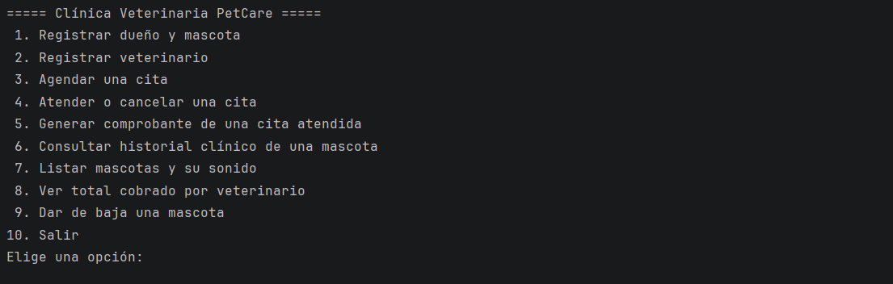
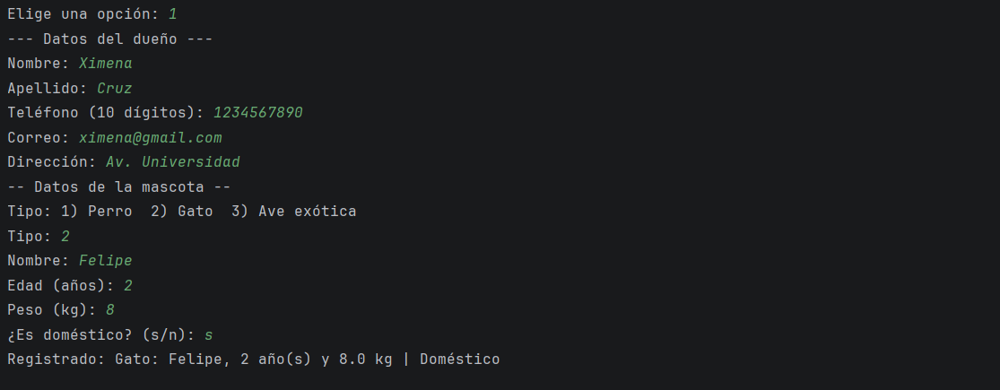
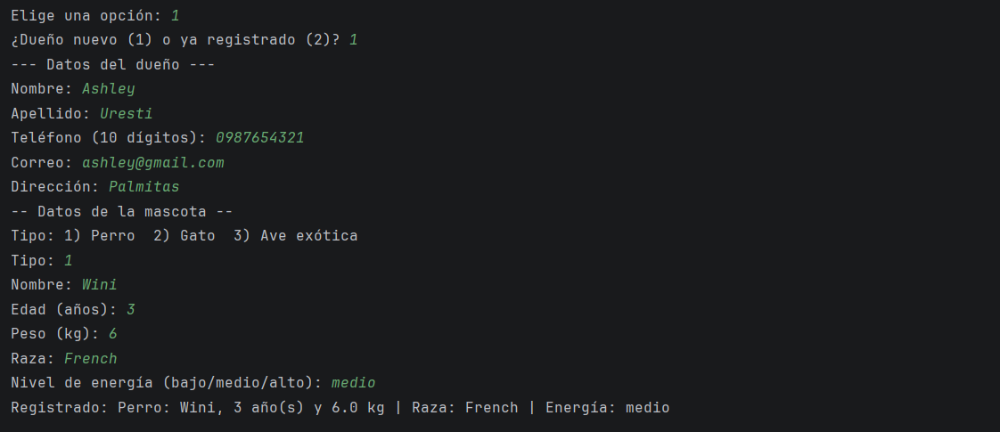
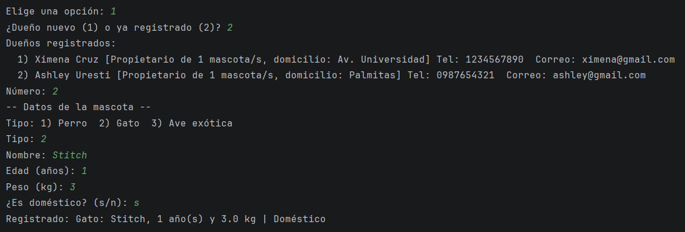
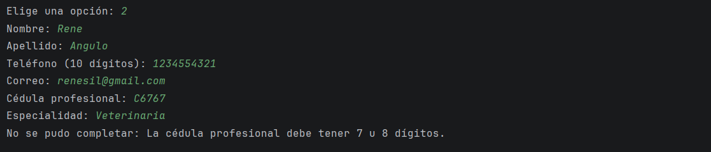
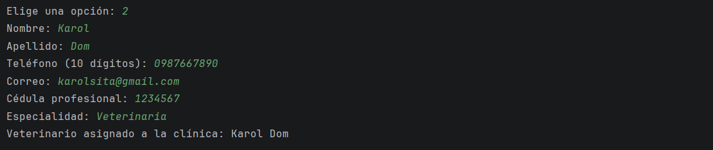
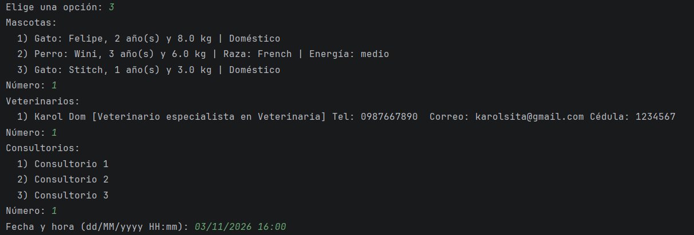
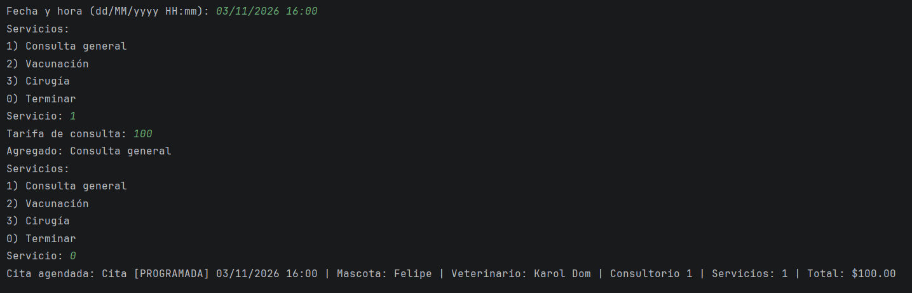
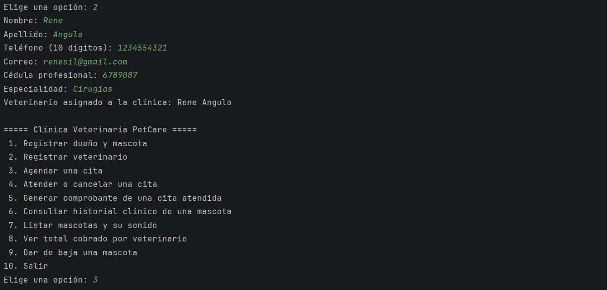
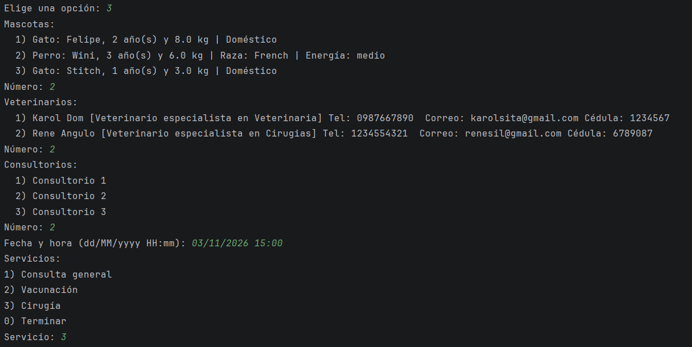
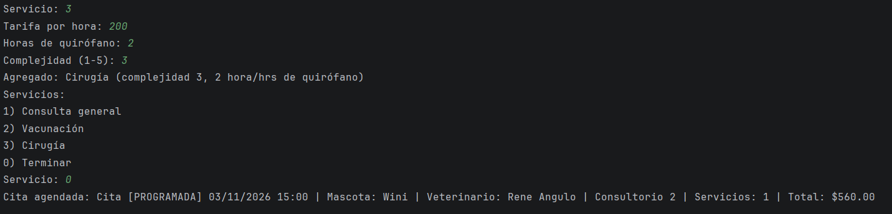
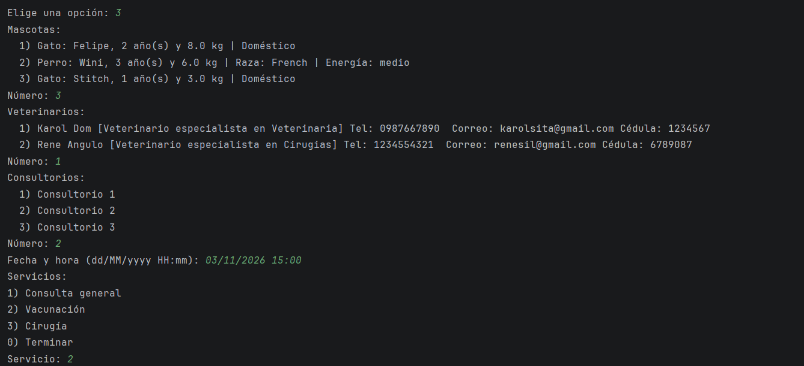
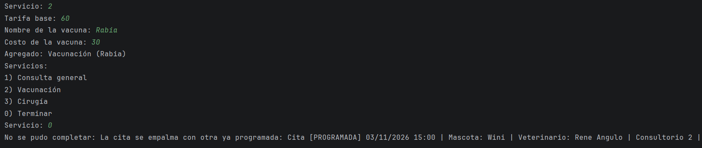
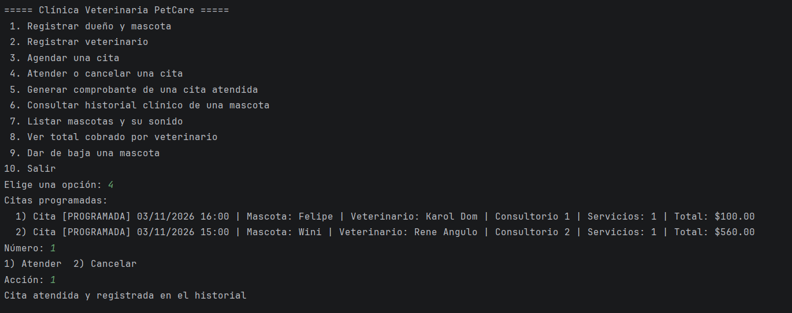
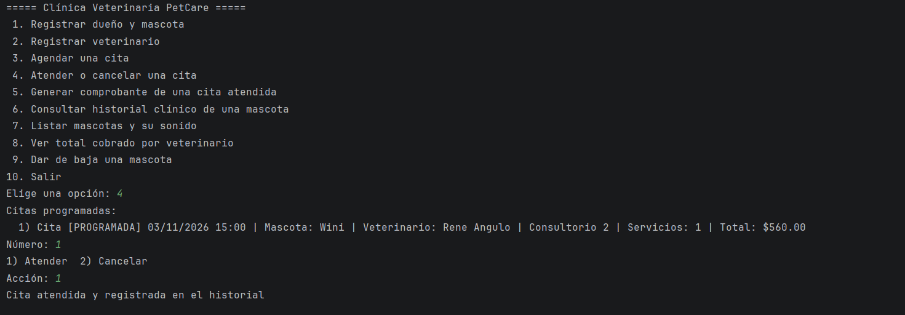
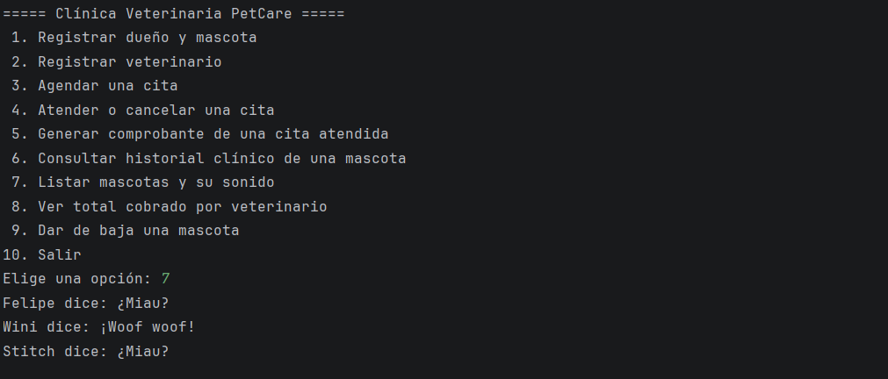
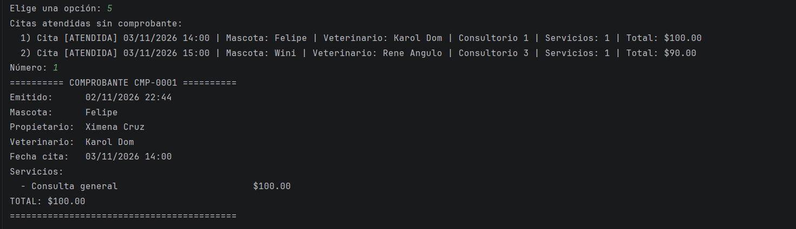
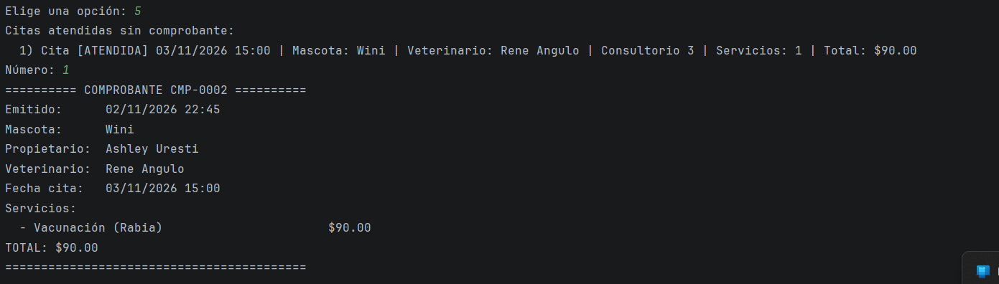
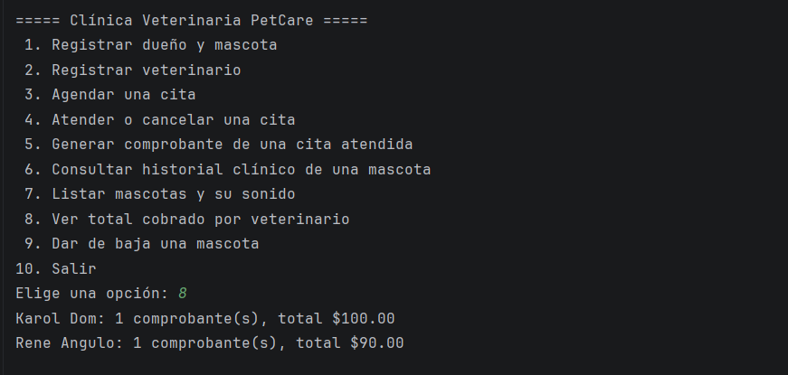
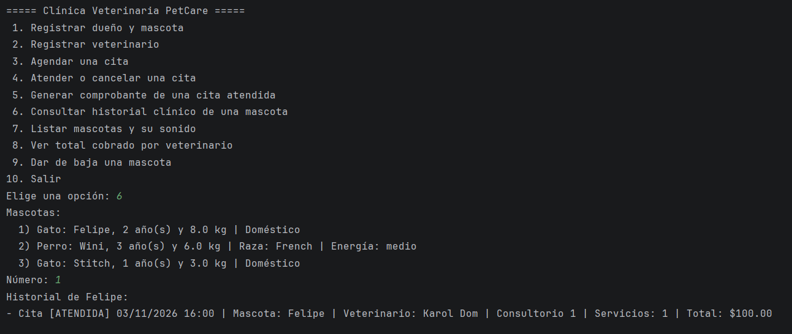


## Reglas de negocio

Las reglas viven en el modelo, no en el menú: si alguien rompe una, la clase lanza `IllegalArgumentException` (dato inválido) o `IllegalStateException` (operación no permitida en el estado actual) y `Main` solo muestra el mensaje

| Regla | Dónde se valida |
|---|---|
| Nombre, apellido, dirección, raza y demás textos no pueden estar vacíos | `validarTexto` |
| El teléfono debe tener 10 dígitos y el correo un formato válido | `Persona` |
| La edad debe estar entre 0 y 60; el peso, entre 0 (sin incluir) y 200 kg | `Mascota`|
| Una mascota debe tener propietario | Constructor de `Mascota` |
| El dueño debe estar registrado antes que su mascota | `Clinica.registrarMascota` |
| No se repiten veterinarios, dueños ni mascotas en la clínica | `Clinica`|
| La clínica necesita al menos un consultorio | `Clinica` |
| Una cita necesita mascota, veterinario, consultorio y fecha | Constructor de `Cita` |
| La mascota, el veterinario y el consultorio de la cita deben pertenecer a la clínica | `Clinica.agendarCita` |
| Una cita debe llevar al menos un servicio | `Clinica.agendarCita` |
| Dos citas programadas no pueden coincidir en fecha y hora si comparten consultorio, veterinario o mascota | `Cita.coincideCon` |
| No se agendan citas en el pasado | `Main` |
| Solo se agregan servicios, se atiende o se cancela una cita que está programada | `Cita` |
| No se puede atender una cita sin servicios | `Cita.atender`|
| Solo se genera comprobante de una cita atendida | `Comprobante`|
| Una cita se cobra una sola vez | `Clinica.generarComprobante`|
| Los folios de comprobante nunca se repiten | Contador `static` en `Comprobante.java:18` |
| Tarifas positivas; cirugía con 1 o más horas y complejidad de 1 a 5 | Constructores de los servicios y `Cirugia` |
| Al dar de baja una mascota se eliminan también sus citas y comprobantes | `Clinica.darDeBajaMascota` |
| Las entradas de consola se repiten hasta ser válidas | `Main` |

## Reflexión

**Qué aprendí:** Aprendí mucho sobre el uso de los tipos de clases, la utilidad de usar paquetes, cómo hacer correctamente los commits y a trabajar desde el IDEA.

**Lo más difícil:** Para mí fue muy, muy complicado el análisis, ya que al pasarlo al diagrama, este crecía y crecía, lo cual me tomó muchas horas y es muy importante, ya que si hace falta algo, hay que estar actualizando todo.

**Qué mejoraría:** Sin dudas mi organización, ya que este es un trabajo que requiere mucho tiempo y me gustaría seguir trabajando y puliendo.

**Uso de IA:** La IA (Claude) me ha ayudado mucho, ya que todas mis dudas se fueron resolviendo y fue muy útil para explicarme con qué paso debía seguir. También para comprobar que no hayan errores en el código.

## Autor

** Ashley Janeth Uresti Martínez **
GitHub: [@ashley-janeth-uresti-martinez](https://github.com/AshleyUresti)